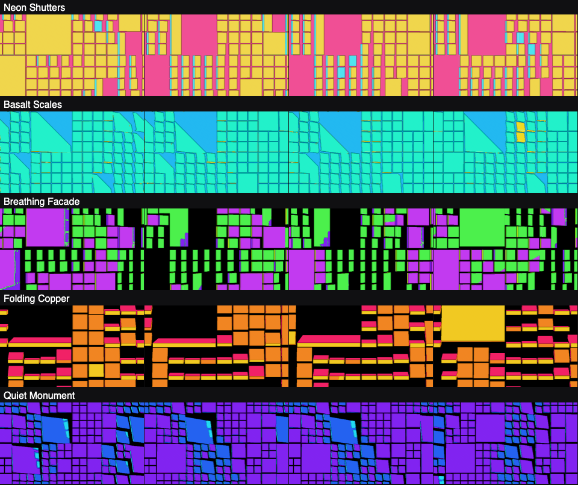

# Kinetic Relief art direction

17 November 2026 · Research and design proposal

**Start with Folding Copper. Give it a moment when a nearly flat wall becomes one enormous copper concertina.** The existing preset already exposes broad bands of darkness as its pieces turn. Join those pieces into pleats and the audience can follow a crease moving from one end of the wall to the other. It gives the instrument a signature that works with the camera locked and the music off.

## What the current instrument actually makes

Each row shows one preset at 0, ¼, ½ and ¾ of its loop. These are fresh renders from the existing Studio renderer, 480 × 270 per frame before reduction for the sheet. Black is the viewing background. Four frames reveal changes in the large shapes and composition. They cannot establish how smooth the motion feels at show speed.

| Preset | What reads in the sheet | Decision |
| --- | --- | --- |
| Neon Shutters | A large yellow square turns pink. Cyan appears in thin vertical strips while the rectangular partition stays prominent. | Keep the quick colour reveal. Make the strips wide enough to become the main image at mid-turn. |
| Basalt Scales | The frame stays turquoise. Diagonals cut across the large squares, but very little reads as one scale overlapping another. | Give the pieces an overlapping lip and lift them along one travelling ridge. |
| Breathing Facade | A large panel repeatedly dominates the smaller green and violet cells. Black openings give the clearest cue that air could pass through it. | Organise the architecture around an aperture whose outline changes as it breathes. |
| Folding Copper | Horizontal yellow and pink edges cut across large black intervals. The changing area of the openings communicates depth even in miniature. | Develop it first. Preserve the dark intervals and build a fold that continues across neighbouring panels. |
| Quiet Monument | The large diagonal blue faces keep roughly the same silhouette against the violet grid. | Keep its restraint. Give the audience one large displacement and time to notice the shadow it leaves. |

There is a concrete reason for the family resemblance. All five presets select the solid construction. It draws one instanced box mesh, varies panel sizes on a square lattice and applies a sinusoidal hinge opening around one orientation per look. Delay, grouping and holds change when panels turn. The geometry supplies one base colour per instance, interpolated between two palette entries, before the shared finish. It has no separately authored face, reverse and edge colours. “Piece bevel” and “Plate rounding” exist in the instrument definition, but the solid mesh is a plain box and its draw path does not use either value. Mixed panel sizes, the fixed camera, real occlusion and deterministic timing are worth keeping. [Preset definitions](../../../src/core/instruments.ts) · [Solid relief renderer](../../../src/rendering/ReliefRenderer.ts)

## Four references and what to take from each

**Carlos Cruz-Diez, *Physichromie*.** Vertical sheets alter how colours interact as the observer or light moves. A small change of angle can transform the colour of a large area. For Neon Shutters, keep the audience still and rotate broad two-colour vanes. A bank of dark indigo faces can turn to expose vermilion sides, so the colour change has an intelligible physical cause. The reference depends on real light and viewing position. Here the intended result is a rendered illusion for a fixed screen. [Atelier Cruz-Diez, work and examples](https://cruz-diez.com/works/physichromie-1959-2019/)

**ART+COM, *Kinetic Rain*.** Changi describes 1,216 individually controlled droplets forming 16 shapes. The relevant decision is that the individual parts have a destination. For Basalt Scales, draw the outline of a single crest first. Then decide which rows lift, overlap and settle to make that crest travel. Check whether the crest is visible with every scale painted the same grey. [Changi Airport, installation and choreography](https://www.changiairport.com/en/experience/attractions-directory/kinetic-rain.html)

**DRIFT, *Shylight*.** The sculpture descends as it opens, then closes and draws upward. A second action gives the first one weight and character. For Breathing Facade, let the centre recede before the outside leaves open. On the return, close the leaves first and bring the centre forward last. The audience sees tension, release and recovery in a few seconds. [DRIFT, artist account and film](https://studiodrift.com/work/shylight/)

**Bot & Dolly, *Box*.** Team member Ian Sherman describes the coordination of projected imagery, lighting, moving surfaces and a virtual camera for a forced-perspective film. For a VJ wall, the useful constraint is simpler. Give the viewer a stationary reference plane and a consistent light direction. When Quiet Monument rises, the ledge should hide the seam behind it and its shadow should move onto the next fixed plane. Those two cues sell the depth even on a flat screen. [Ian Sherman, production account and film](https://www.ianjsherman.com/work/box/)

## Five looks worth making

These are proposed visual studies. Keep the existing preset IDs and appearance available to old projects. Use a new preset or construction version when a proposal changes the geometry or the motion.

| Look | Physical action and composition | Colour, material and light | What the operator plays |
| --- | --- | --- | --- |
| **Folding Copper → Copper Concertina** | A diagonal crease catches in a nearly flat sheet. Alternating facets buckle into six broad pleats. At the peak, one uninterrupted triangular shadow crosses several folds. The crease exits along the opposite edge and the sheet settles flat. | Brushed copper face, oxblood reverse, a warm narrow rim. Light from upper left. Keep a matte area beside the highlight so the copper feels broad and heavy. | Opening controls fold depth. One sweep changes which end catches first. A slow version should feel like bent sheet metal, a fast one like a mechanical fan. |
| **Neon Shutters → Signal Vanes** | Three banks of tall vertical fins. The middle bank turns first, revealing a vermilion bar. The outer banks answer on alternate beats. For one beat all three align into a second wall-wide graphic. | Indigo front, vermilion reverse, warm white ends. Reserve white for edge-on moments. A few broad fins should still read in a narrow Map shape. | Spread moves between a simultaneous colour cut and a travelling reveal. Finish each turn before starting the next group. |
| **Basalt Scales → Fault Line** | Overlapping shield-shaped plates cover the frame. One diagonal pressure ridge lifts their leading edges. A second, smaller row settles just behind it, leaving a clearly visible wake. | Charcoal-blue face, pale mineral edge, a sulphur-yellow underside visible only along the fault. The overlap and shadow establish which plate sits above the next. | Depth changes how much underside is exposed. Width changes a single sharp fault into a broad swell. |
| **Breathing Facade → Bellows Court** | Four banks of linked leaves surround an off-centre diamond. A shallow central well pulls back, the leaves open in pairs, the diamond hangs open, then the perimeter closes around it. Keep some structure visible at full opening. | Matte chalk face, saturated violet inner walls, a dark floor in the well. One stable rim makes the changing aperture easy to judge. | A breath control changes the aperture. A hold control lengthens its suspended open pose. Preserve the ordering at short loop lengths. |
| **Quiet Monument → Counterweight** | Three unequal stone slabs. One rises slowly while another sinks, revealing a continuous stepped plinth. A narrow bright seam appears at maximum separation. Pause there, then let the third slab take the weight. | Ultramarine stone, near-black recess, one pale edge. Give the shadow a broad receiving surface. Keep the largest plane quiet enough to show on another layer behind a performer. | Travel sets the height exchange. Dwell sets the sense of weight. This is the slow look in the set. |

### First study to approve

An eight-beat Copper Concertina loop is enough to judge the direction. On **1–2** the sheet lies nearly flat and the first crease catches at the lower left. On **3–4** it travels diagonally and exposes successive oxblood reverse faces. On **5** the silhouette reaches full depth and holds for a beat. On **6–7** the far pleats pull the sheet straight in sequence. On **8** the last edge settles and the next opening can begin from rest. At 120 BPM that is four seconds. Beat counts describe the visual rhythm and do not require audio input.

Approve the four poses in grey first. A viewer should be able to point to the active crease and tell which pair of neighbouring faces share a hinge. Then approve copper, reverse colour and rim light in that order. If the fold only becomes convincing after bloom or a camera move, revisit the geometry.

## What this would require

- **Closest to the current renderer:** Signal Vanes can reuse instancing, the fixed camera and the timing system. It needs elongated vanes, front/reverse material roles and a turn that actually exposes the reverse. The current maximum opening is about a quarter-turn, so changing the palette alone cannot deliver the reveal.
- **Best first investment:** Copper Concertina needs shared crease positions and alternating facet orientations. Two neighbouring facets must agree on their hinge throughout the loop. Independently rotating boxes will open cracks or pass through one another.
- **Distinct follow-ons:** Fault Line needs overlapping tapered geometry. Bellows Court needs an aperture layout and coordinated lift plus rotation. Counterweight needs depth translation and a fixed shadow receiver. Each can continue to use a bounded, phase-driven pose for export and scrubbing.
- **Performance controls:** retain familiar Opening, Depth, Spread and Hold where they describe what is on screen. Label colour roles by visible part. For Vary, preserve each look’s mechanism, dominant direction and landmark pose. Vary proportions, starting edge, spacing and palette within those constraints.

## Review at show scale

| Check | Proposed approval criterion |
| --- | --- |
| Identity | At 240 px wide and in greyscale, a reviewer can distinguish the fold, vanes, scales, aperture and slabs from their landmark poses. If two are confused, revise their silhouettes. |
| Motion | Watch each loop at full speed twice, first silently. A reviewer can describe what moved, where it went and when it arrived. A hold should read as a deliberate pose. |
| Projection | Check a 1080p wall from the audience position, then try a narrow Map shape. The important edge and shadow survive projection softness. Fine rims can disappear without losing the action. |
| Compositing | Check over black, mid-grey and a moving saturated layer. A designed opening shows the underlying layer when transparent. Shadows land on intended geometry and cutout edges have no dark fringe. |
| Loop and export | Scrub forward and backward through the same phase and compare still/export frames. Watch the last frames into the first for a hitch in speed as well as a jump in position. Check 24, 30 and 60 fps. |
| Runtime | Compare frame-time distributions for old and proposed Relief on the same hardware and scene, first solo and then in a four-layer composition and multi-shape Map show. Qualify export separately at 4K. Record measured values before adopting defaults. |

The order I would commission is **Copper Concertina**, then **Counterweight**. Together they test both ends of the instrument: fast hinged sheet motion and slow architectural mass. If both read convincingly with one light and a fixed camera, the remaining three have a clear standard to meet.
